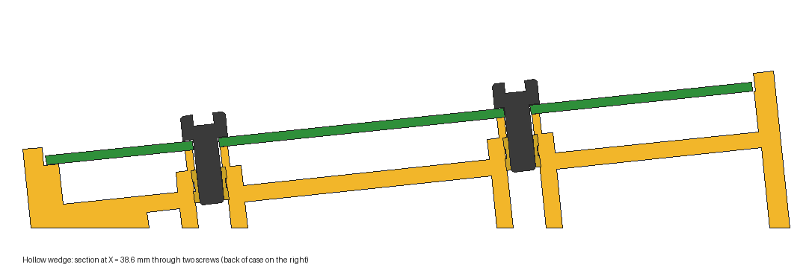

The [MadRP2040 keypad](madrp2040-anything-keypad) now has a case. The first one is waiting for the printer.

## The shape

A 6° wedge, printed in one piece. The board drops into a tray and is held by four M3 screws into heat-set inserts.

The screws only locate the board. Typing loads go somewhere else. A 1.5 mm ledge runs around the edge and small pads sit under the switches between the hot-swap sockets, so every key press goes into the case rather than bending the PCB. A rough beam model put the flex at about 0.65 mm on the screws alone. With the ledge and pads it drops to about 0.005 mm.

<figure>
  
  <figcaption>Section through two screws. The wedge is hollow with ribs, and the inserts load from below against a shoulder.</figcaption>
</figure>

## Details

- **Hollow wedge with ribs.** It saves plastic and print time without losing stiffness under the keys.
- **Inserts load from the bottom.** An M3 insert won't fit through a 3.4 mm clearance hole, so each insert presses up from underneath against a shoulder.
- **Real socket clearance.** The Kailh Choc hot-swap sockets were missing from the board's STEP export. The cause was a KiBot path alias, fixed in [Mad_RP2040 #19](https://github.com/Cimos/Mad_RP2040/issues/19). The case is cut around the real socket model, with 0.55 mm to spare.
- **Softer connector openings.** The USB-C and TRS cut-outs have rounded corners and a chamfer. They are checked against the plug overmoulds, not just the sockets.
- **Underglow.** The clear version glows straight through the plastic. The opaque versions get light holes through the floor. Recesses for 10 mm rubber feet lift the case off the desk.

## Versions

| Version | Case | Underglow |
|---|---|---|
| **Clear** (printing first) | Whole case in clear PETG | Glows through the plastic |
| Plate | Opaque case, clear 2 mm base plate | Through the plate, held by M2 pan-head screws |
| Hollow / solid | Opaque case | Light holes through the floor |

## How it's built

The case is a CadQuery script driven by a parameter file, so each version is just a different set of numbers. Every build runs fit checks before it exports a STEP and STL. They cover part interference, socket clearance, the USB and TRS plug paths, screw engagement and insert depth. The clear version passes all 142.

Next is the first print. Fit notes will follow.
