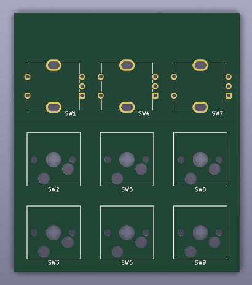

CrumbCatcherLight is my wireless keyboard board. It's early, and it's been through a few brains already, but it's public on GitHub at [Cimos/CrumbCatcherLight](https://github.com/Cimos/CrumbCatcherLight) so here's where it's at.

## What's on it

- **nRF52840** as a module (MDBT50Q), so Bluetooth without doing my own RF layout.
- **LiPo charging** with a TI BQ24075, plus an input for a Qi wireless charger.
- **USB-C** for charging and wired use.
- **Per-key RGB** with SK6812 Mini-E LEDs that shine up through the switch.
- **Tag-Connect** for SWD programming, no header to solder.

The board in the PCB file right now is a 3 x 3 test layout: six hot-swap MX keys and three rotary encoders. A 34-key Choc layout is sitting in the schematic next to it.

<figure>
  
  <figcaption>KiCad render of the test board. Encoders across the top, MX hot-swap below. Nothing's routed yet.</figcaption>
</figure>

## How it got here

- **October 2023.** Started with a Teensy, then swapped to an STM32.
- **March 2024.** Moved to the RP2040, added USB ESD protection, rotary encoders and KiBot CI.
- **November 2025.** Swapped to the nRF52840 to go wireless, and added the battery charger on its own sheet.

The RP2040 side of things carried on in [Mad_RP2040](). This one is the wireless branch.

## What's left

Pretty much all the PCB. The schematic is mostly there. Still open: speccing the connectors properly, what the Tag-Connect VCC pin hooks to, placing the parts and routing it all.

-SM
