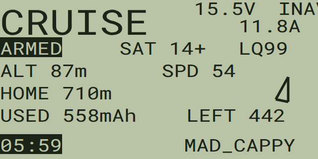
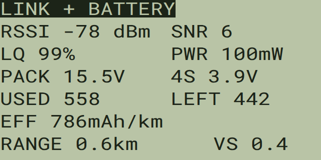
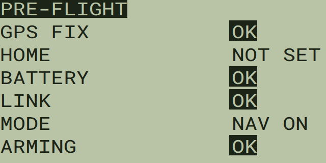

The RadioMaster Boxer has a 128 x 64 mono screen. I wanted one telemetry screen on it that works whatever's on the other end of the link, INAV, Betaflight or ArduPilot, without swapping scripts for every model. So I wrote FCTEL.

It's an EdgeTX Lua script over CRSF/ELRS. Code is on GitHub at [Cimos/fc-telem](https://github.com/Cimos/fc-telem), GPL-3.0.

## Three pages

Scroll wheel flips between them. The PAGE buttons still move between EdgeTX's own telemetry screens.

<figure>
  
  <figcaption>Main page in flight: mode, arm state, GPS and link, altitude, speed, distance and arrow home, battery used and left, flight time.</figcaption>
</figure>

<figure>
  
  <figcaption>Link and battery: RSSI, SNR, TX power, per-cell voltage, mAh per km and estimated range.</figcaption>
</figure>

<figure>
  
  <figcaption>Pre-flight checklist. Here it's not happy yet: no home point and a nav mode selected.</figcaption>
</figure>

These are drawn from the real script running in the test harness, not photos of the radio, so the font is close but not exact.

## Working out what it's talking to

At startup the script pings the flight controller over CRSF every two seconds and reads the name it sends back. INAV, Betaflight or ArduPilot loads the matching profile. If nothing answers in eight seconds it falls back to guessing from the flight mode string. Change model or plug in a different aircraft and it starts over.

Only one firmware profile is ever loaded. The 128 x 64 radios don't have much Lua memory, so the shared screen code lives in one file and each firmware is a small file loaded on demand.

- **INAV and Betaflight** get polled over MSP for arm state and why arming is blocked. Betaflight shows up to three reasons.
- **ArduPilot** doesn't need MSP. It uses the flight mode names it already sends.
- **Voice** calls out mode changes, with alerts for low link, low battery and failsafe.

## The gotcha: EdgeTX Lua isn't desktop Lua

On the 128 x 64 radios EdgeTX strips Lua right down. No `table` library, no `os`, and strings have no methods, so `s:sub()` just fails. Code that runs fine on a PC falls over on the radio.

So the tests run the real script in Lua 5.3 with the same bits ripped out, fake sensors feeding it. There's also a debug console over USB and a push tool that copies updated scripts onto the radio with a checksum, so I'm not pulling the SD card every time I change a line.

## Next

More flying with it on all three firmwares, and tidying up the voice clips.

-SM
